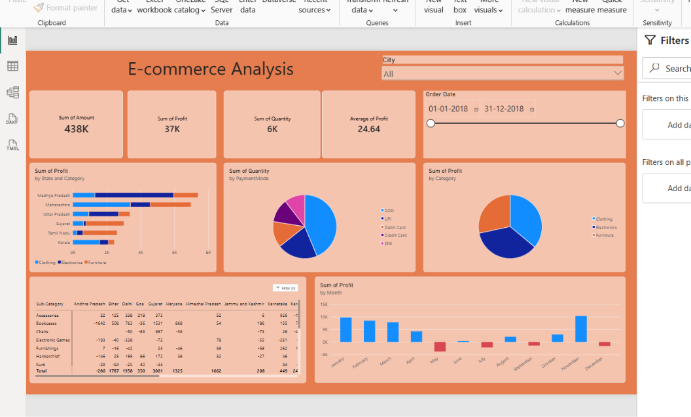

# E-commerce Analysis Dashboard | Power BI

## Project Overview
Developed an interactive E-commerce Analysis Dashboard using Microsoft Power BI to analyze sales, profit, quantity, payment methods, categories, and monthly business performance.

## Objectives
- Analyze overall sales and profit performance.
- Understand category-wise and state-wise profitability.
- Identify popular payment methods.
- Track monthly profit trends.
- Provide interactive filtering for business analysis.

## Tools & Technologies
- Microsoft Power BI
- Power Query
- DAX (if used)
- Excel / CSV

## Dashboard Features
- KPI Cards: Total Amount, Total Profit, Total Quantity, Average Profit.
- Profit by State and Category.
- Sales by Payment Mode.
- Profit by Category.
- Sub-Category and State Analysis.
- Monthly Profit Analysis.
- Interactive City and Order Date Filters.

## Dashboard Preview

## Files Included
- Power BI dashboard (.pbix)
- Dataset (Excel/CSV)
- Dashboard screenshot

## Key Learnings
- Data cleaning and transformation.
- Data visualization and dashboard development.
- Business performance analysis.
- Identifying trends and insights from data.

## Author
B.Tech Graduate | Computer Science and Engineering

GitHub: Add your GitHub profile link here.

